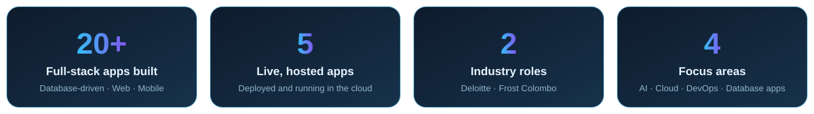

<p align="center">
  
</p>

<p align="center">
  <a href="https://www.linkedin.com/in/ashane-ar/"></a>
  <a href="mailto:alarangalla@gmail.com"></a>
  <a href="https://medium.com/@alarangalla"></a>
  <a href="https://www.upwork.com/freelancers/~0112945997605f472d"></a>
</p>

> [!TIP]
> **Open to work:** graduate and junior **software engineering** roles in Australia, especially in **AI, cloud or DevOps**. Based in Perth and available now.

---

## 🧑‍💻 About me

I'm a software engineer based in **Perth, Australia** 🇦🇺, with a strong interest in **AI, cloud and DevOps**. I build AI-powered and database-driven applications (RAG pipelines, AI agents, REST APIs) and I'm growing my skills in **Azure**, containers and **CI/CD** to ship them reliably. With 20+ full-stack apps behind me, I care about taking software past "it works on my machine" to something that's deployed, monitored and maintainable.

<p align="center">
  
</p>

```yaml
name: Ashane Arangalla
location: Perth, WA
currently:
  - Freelance developer on Upwork
education:
  - Bachelor of Computing (Software Engineering), Curtin University · with Distinction · CWA 82.09
  - Higher Diploma in Computing & Software Engineering (Distinction), Cardiff Metropolitan University
experience:
  - Intern Software Developer @ Deloitte (WORK3008 Go Practice Internship, Curtin), 2026
  - Associate Software Developer @ Frost Colombo (2024)
focus_areas: [AI engineering, cloud (Azure), DevOps & CI/CD, database-driven apps]
builds: [AI agents, RAG apps, database-driven web apps, REST APIs]
learning: [AZ-900, AI-901, AZ-104, Jenkins pipelines]
off_keyboard: competitive cricket 🏏 (teamwork, discipline and strategy)
```

### 🧭 My journey

<p align="center">
  
</p>

---

## 🚀 What I bring

| | |
|---|---|
| 🤖 **AI & LLM engineering** | RAG pipelines (LangChain, Qdrant, OpenAI), tool-calling AI agents with human-in-the-loop approval, prompt grounding with source citations, async inference with job queues |
| 🧠 **Machine learning** | Graph neural networks in PyTorch Geometric (GINEConv, GraphSAGE, GATv2) and a hybrid quantum GNN with PennyLane, served from a model microservice |
| ☁️ **Cloud (Azure)** | Azure Container Apps, Container Registry, Key Vault, managed identity, Blob Storage, Log Analytics (KQL); secure secret handling |
| 🔁 **DevOps & CI/CD** | Docker and Docker Compose, Jenkins pipelines, Git and Gitflow workflows, database migrations in deploys (Alembic, EF Core), Linux |
| 🗄️ **Database-driven apps** | Relational schema design and migrations on PostgreSQL, MySQL and SQL Server; ORMs (SQLAlchemy, SQLModel, EF Core); full-stack apps from database to UI |
| ⚙️ **Backend & APIs** | FastAPI, ASP.NET Core, Node/Express and PHP REST APIs; JWT auth; RQ/Valkey workers; SQLAlchemy and EF Core |
| 🖥️ **Frontend & mobile** | React + TypeScript + Vite + Tailwind, D3 visualisations, Streamlit, native Android (Java), JavaFX |
| 🏗️ **Software design** | Plugin architectures, repository pattern, modular builds (JPMS/Gradle), Gitflow team workflows |

---

## 🛠️ Tech stack

<p align="center"><b>AI / ML</b><br/><br/>
  
  
  
  
  
  
  
  
  
</p>

<p align="center"><b>Cloud & DevOps</b><br/><br/>
  
  
  
  
  
  
</p>

<p align="center"><b>Languages</b><br/><br/>
  
  
  
  
  
  
  
</p>

<p align="center"><b>Frameworks & libraries</b><br/><br/>
  
  
  
  
  
  
  
  
  
</p>

<p align="center"><b>Databases & tools</b><br/><br/>
  
  
  
  
  
  
</p>

---

## 🌟 Featured projects

<table>
<tr>
<td width="50%" valign="top">

### ⚛️ [Q-Detect](https://github.com/ThaiGiaNganNGUYEN/Q-Detect)
**Hybrid quantum-classical money-mule detection** · *Curtin capstone with Deloitte*

Treats bank transactions as a graph and scores each one with GNNs, including a 2-qubit **PennyLane quantum GNN**. A crash-safe poller streams 50k-transaction batches through a model-serving microservice, and flagged activity is grouped into mule networks that analysts review in a D3 dashboard.

    

</td>
<td width="50%" valign="top">

### 📚 [rag-async](https://github.com/ashanearangalla/rag-async)
**Asynchronous RAG chat assistant for PDFs**

Questions are queued with RQ/Valkey and answered by background workers. They retrieve chunks from Qdrant and call OpenAI with conversation memory, and every answer cites its source page. Includes JWT auth, per-user chat history and Alembic migrations.

    

</td>
</tr>
<tr>
<td width="50%" valign="top">

### 📸 [social-media-app](https://github.com/ashanearangalla/social-media-app)
**Instagram-style app deployed to Azure**

Full auth lifecycle with fastapi-users, image and video posts stored in Azure Blob Storage, and non-blocking uploads. Containerised with Docker and deployed to **Azure Container Apps** with ACR, Key Vault and managed identity.

   

</td>
<td width="50%" valign="top">

### 🎟️ [eventMgtSys](https://github.com/ashanearangalla/eventMgtSys)
**Event ticketing platform**

An ASP.NET Core 8 Web API with EF Core, the repository pattern and AutoMapper, plus a PHP frontend for customers, event partners and admins. Handles ticket types, sales and commission tracking. The backend is containerised and deployed to Azure.

   

</td>
</tr>
<tr>
<td width="50%" valign="top">

### 🧩 [texteditor](https://github.com/ashanearangalla/texteditor)
**Extensible JavaFX text editor**

Loads plugin JARs at runtime using reflection and Groovy scripts through a shared API. Key bindings come from a custom DSL parsed with **ANTLR**, and the UI is localised into English and Sinhala.

    

</td>
<td width="50%" valign="top">

### 🐾 [PawPal](https://github.com/ashanearangalla/pawpal)
**Native Android pet-care booking app**

Pet owners post care requests, and caregivers search for and accept them. Built with separate role-based flows, bottom navigation and on-device SQLite.

  

</td>
</tr>
<tr>
<td colspan="2" valign="top">

### 🚌 [ezBusLK](https://github.com/ashanearangalla/ezBusLK)
**Online bus seat booking for Sri Lanka**: trip search, a seat map with a 5-minute seat hold, e-tickets, email confirmations, and dashboards for admins and operators.

  

</td>
</tr>
</table>

<details>
<summary><b>💼 Also built (client and freelance work)</b></summary>
<br/>

- **AI customer-support agent** for an e-commerce client (Aromatic Hug). It uses FastAPI and Gemini tool-calling, with an approval queue for sensitive actions and least-privilege database access with column allowlists to protect customer data.
- **AutoDevOps**: a MERN-stack infrastructure co-pilot, live at [cmcloud.online](https://cmcloud.online)
- E-commerce builds for freelance clients, with AI chatbots
- REST APIs in FastAPI and plain PHP with JWT auth, including a Sri Lanka public holidays API

</details>

---

## 🎯 Currently

- 🌱 Studying **AI engineering and cloud computing** every day: AZ-900 → AI-901 → AZ-104
- 🔁 Learning **CI/CD pipelines** with Jenkins and containerised deploys to Azure
- ✍️ Writing about cloud deployments in plain language on [Medium](https://medium.com/@alarangalla)
- 🤝 Open to **graduate and junior software engineering roles** in Australia, especially in AI, cloud or DevOps

---

<p align="center">
  <i>"Prefer working code over theory, and always ask why."</i>
</p>

<p align="center">
  
</p>
